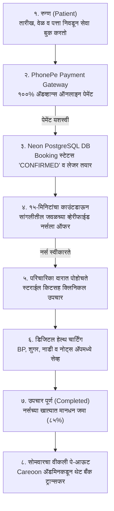

# Careoon (केअरून) — Executive Briefing & Operating Manual
**विषय: सांगली-मिरज होम नर्सिंग मार्केटप्लेस: कार्यप्रणाली, तांत्रिक पाया, आर्थिक मॉडेल आणि चाचणी मार्गदर्शक**  
**तयार केले: Careoon Core Engineering Team**  
**सादरकर्ते: सुवर्णा पाटील मॅडम (Founder & Director)**  
**तारीख: नोव्हेंबर २०२६**

---

## १. कार्यकारी सारांश (Executive Summary)

**Careoon** हे सांगली, मिरज आणि कुपवाड परिसरासाठी तयार केलेले **महाराष्ट्रातील पहिले व्हेरिफाइड, डॉक्टर-प्रिस्क्राईब्ड मोबाईल-फर्स्ट होम नर्सिंग प्लॅटफॉर्म** आहे. 

गेल्या काही दिवसांत आपण मॅडमच्या सूचनेनुसार प्लॅटफॉर्ममधील सर्व तांत्रिक त्रुटी (Bugs), डेटाबेस स्ट्रक्चर, पेमेंट गेटवे आणि सुरक्षिततेचे निकष १००% पूर्ण केले आहेत. हे डॉक्युमेंट सिस्टीम कशी काम करते, डेटा कुठे साठवला जातो, पैशांचा व्यवहार कसा चालतो आणि ॲडमिन म्हणून प्लॅटफॉर्म कसा चालवायचा, हे स्पष्ट करण्यासाठी तयार केले आहे.

> [!NOTE] 
> **लाईव्ह वेबसाइट लिंक:** [careoon-kappa.vercel.app](https://careoon-kappa.vercel.app)  
> **डेटाबेस:** Neon Cloud PostgreSQL (AWS Serverless)  
> **पेमेंट पार्टनर:** PhonePe Payment Gateway (UPI / QR / GPay / Cards)

---

## २. सुवर्णा मॅडमच्या सर्व ५ फीडबॅक्सचे झालेले निवारण (Resolved Action Items)

| # | मॅडमचा फीडबॅक | आधीची समस्या | आता केलेले १००% पक्के सोल्युशन |
|---|---|---|---|
| **१** | *"Admin panel मध्ये Patient database दिसत नाही"* | रुग्णांची स्वतंत्र यादी नव्हती. | **`/admin/patients`** हा नवीन स्वतंत्र टॅब जोडला. यामध्ये रुग्णाचे नाव, १०-अंकी फोन, पत्ता, रक्तगट, जुनाट आजार, ॲलर्जी आणि मागील सर्व भेटींचा इतिहास एका क्लिकवर उपलब्ध आहे. |
| **२** | *"Patient mobile number kiti digita chaltoy, validation nahi"* | कोणताही चुकीचा नंबर जायचा. | **भारतीय १०-अंकी मोबाईल नंबर (`/^[6-9]\d{9}$/`)** सक्तीचा केला. १० अंकांपेक्षा कमी किंवा अक्षरे टाकल्यास सिस्टीम फॉर्म सबमिटच होऊ देत नाही. |
| **३** | *"Nurse login kele war show her name"* | नर्सचे नाव स्पष्ट दिसत नव्हते. | नर्स लॉगिन होताच वरच्या मुख्य हेडरवर आणि बॅनरवर तिचे नाव (उदा. *नमस्ते, ज्योती चव्हाण*), तिचा युनिक **Nurse ID (उदा. `SANGLI-RN-7401`)** आणि **MNC Registration Number** ठळकपणे दिसतो. |
| **४** | *"Patient can't book previous date & time"* | मागील वेळ निवडता येत होती. | **कॅलेंडरमध्ये मागील तारीख ब्लॉक केली (`min={today}`)**. आजची वेळ निवडताना जी वेळ उलटून गेली आहे (उदा. दुपारी २ वाजता सकाळी १० चा स्लॉट) ती आपोआप **Disable** होऊन त्यावर `[वेळ उलटून गेली]` असा स्पष्ट टॅग येतो. |
| **५** | *"३ खिडक्यांमध्ये लॉगिन केल्यावर लॉगआउट होते"* | एकाच कुकीमुळे सेशन क्लॅश व्हायचे. | तिन्ही भूमिकांसाठी स्वतंत्र कुकीज तयार केल्या: <br>• ॲडमिन: `careoon_admin_session`<br>• नर्स: `careoon_nurse_session`<br>• रुग्ण: `careoon_patient_session`<br>**आता एकाच लॅपटॉपवर तिन्ही स्क्रीन्स एकाच वेळी लॉगआउट न होता अखंड चालतात.** |
| **६** | *"स्क्रीन क्लिक केल्यावर मधेच काळी पडत होती (Black Screen)"* | युझरच्या मोबाईल/लॅपटॉपचा Dark Mode चालू असल्यामुळे काही भाग काळा व्हायचा. | सिस्टीममधून सर्व Dark Mode क्लासेस काढून **`color-scheme: light only` (१००% क्लिनिकल व्हाईट व टील)** सक्तीचे केले. सोबत `error.tsx` रिकव्हरी लावली. |

---

## ३. Careoon ची संपूर्ण कार्यप्रणाली (End-to-End Workflow)



---

## ४. डेटाबेस रचना: डेटा कुठे आणि कसा सेव्ह होतो? (Database Schema)

आपला संपूर्ण डेटा **Neon Cloud PostgreSQL** वर ११ सुरक्षित टेबल्समध्ये साठवला जातो:

```
┌────────────────────────────────────────────────────────────────────────┐
│                        NEON POSTGRESQL DATABASE                        │
├─────────────────────┬──────────────────────────────────────────────────┤
│ टेबलचे नाव          │ काय साठवले जाते?                                │
├─────────────────────┼──────────────────────────────────────────────────┤
│ 1. User             │ रुग्ण, नर्स आणि ॲडमिनचे लॉगिन, पासवर्ड हॅश, फोन   │
│ 2. NurseProfile     │ MNC लायसन्स, अनुभव, रेटिंग, बँक खाते (IFSC)     │
│ 3. ServiceCategory  │ सेवेचे प्रकार (उदा. पोस्ट-सर्जरी, जखमेचे ड्रेसिंग)│
│ 4. Service          │ मूळ किंमत (Base Price) व कमिशन टक्केवारी (15%)    │
│ 5. Booking          │ तारीख, वेळ, पत्ता, क्लिनिकल नोट्स, Vitals (BP)    │
│ 6. BookingOffer     │ नर्सला गेलेली १५ मिनिटांची कालबाह्य ऑफर           │
│ 7. Payment          │ PhonePe ट्रान्झॅक्शन आयडी, तारीख, स्टेटस (PAID)   │
│ 8. Payable          │ नर्सला द्यायचे मानधन (Weekly Payout Ledger)      │
│ 9. PayoutBatch      │ दर सोमवारी होणाऱ्या बँक ट्रान्सफरचा हिशोब         │
│ 10. Review          │ रुग्णाने दिलेले १ ते ५ स्टार रेटिंग व अभिप्राय     │
│ 11. AuditLog        │ ॲडमिनने केलेले सर्व बदल (अपरिवर्तनीय रेकॉर्ड)     │
└─────────────────────┴──────────────────────────────────────────────────┘
```

> [!IMPORTANT]
> **सुरक्षा हमी:** कोणताही युझर ब्राऊझरच्या "Inspect Element" मधून दर किंवा स्टेटस बदलू शकत नाही. सर्व आर्थिक आकडेवारी सर्व्हरवर डेटाबेसमधून थेट मोजली जाते.

---

## ५. आर्थिक ताळेबंद: पैसा कसा येतो, कसा वाटला जातो? (Financial Model)

> $$\text{रुग्णाने भरलेली रक्कम} = \text{केअरूनचे कमिशन (१५% ते २०%)} + \text{नर्सचे मानधन (८०% ते ८५%)}$$

### उदाहरण: शस्त्रक्रियेचे ड्रेसिंग (किंमत ₹५००)
1. **रुग्ण भरतो (PhonePe Gross):** ₹५०० (बुकिंग करतानाच १००% जमा).
2. **PhonePe सेटलमेंट:** दुसऱ्याच दिवशी सकाळी (T+1) ₹५०० थेट **Careoon च्या बँक खात्यात** जमा होतात.
3. **केअरूनचे कमिशन (१५%):** **₹७५** हा आपला निव्वळ नफा (Net Margin) आहे.
4. **नर्सचे मानधन (८५%):** **₹४२५** हे नर्सच्या लेजरमध्ये `Payable` म्हणून साठवले जाते.
5. **नर्सला पेमेंट कधी जाते?:** दररोज न देता **प्रत्येक सोमवारी** बँक खात्यात NEFT/IMPS द्वारे पाठवले जाते. यामुळे आपल्याकडे आठवडाभर कॅश फ्लो (Positive Cash Float) सुरक्षित राहतो.

---

## ६. ॲडमिन ऑटोमेशन vs. स्टार्टअप वास्तव (Admin Role & Expectations)

मॅडमचे म्हणणे अगदी बरोबर आहे की भविष्यात सर्व काही पूर्ण ऑटोमॅटिक झाले पाहिजे. सध्या आपल्या सिस्टीममध्ये खालील गोष्टी **१००% ऑटोमॅटिक** आहेत:
-  बुकिंग तयार होणे आणि किंमत मोजणे.
-  PhonePe द्वारे पेमेंट व्हेरिफिकेशन.
-  नर्सला १५ मिनिटांची ऑफर पाठवणे आणि कालबाह्य झाल्यावर दुसऱ्या नर्सकडे वळवणे.
-  कमिशन आणि नर्सच्या मानधनाची वजाबाकी (Zero Mismatch).
-  रुग्णाचे बीपी, शुगर आणि डिजिटल हेल्थ चार्ट सेव्ह होणे.

### सुरुवातीला ॲडमिनला थोडे मॅन्युअल लक्ष का द्यावे लागेल?
आरोग्य सेवेत (Healthcare) रुग्णाचा जीव महत्त्वाचा असतो. Urban Company किंवा Practo देखील सुरुवातीला खालील गोष्टी मॅन्युअली तपासतात:
1. **नर्सचे MNC लायसन्स पडताळणी:** एखादी नवीन नर्स नोंदणी करते, तेव्हा तिचे कागदपत्र खरे आहेत की खोटे, हे ॲडमिनने `/admin/nurses` वरून तपासून **"Approve"** करावे लागते (रुग्णांच्या सुरक्षेसाठी हे कायद्यानुसार बंधनकारक आहे).
2. **सुरुवातीचा फोन सपोर्ट:** सांगलीतील वयोवृद्ध रुग्ण किंवा नातेवाईक पहिल्यांदा ॲप वापरताना फोन करून विचारू शकतात.
3. **सोमवारचा बँक पे-आऊट:** सोमवारी ॲडमिनने `/admin/finance` मध्ये जाऊन आठवड्याची एकूण रक्कम तपासून एका क्लिकवर बँकेतून पाठवायची असते.

---

## ७. लाईव्ह टेस्टिंग क्रेडेंशियल्स (Testing Guide for Ma'am)

सुवर्णा पाटील मॅडम स्वतः खालील लिंक्स आणि आयडी वापरून तिन्ही स्क्रीन्स ५ मिनिटांत तपासू शकतात:

### अ. ॲडमिन पॅनल (Admin Operations Console)
- **थेट लिंक:** [careoon-kappa.vercel.app/admin/login](https://careoon-kappa.vercel.app/admin/login)
- **ईमेल:** `admin@careoon.com`
- **पासवर्ड:** `admin123`
- *काय तपासावे:* Patients Database, Services & Pricing, Bookings Operations Board, आणि Financial Ledger.

### ब. परिचारिका पोर्टल (Nurse Portal)
- **थेट लिंक:** [careoon-kappa.vercel.app/nurse/login](https://careoon-kappa.vercel.app/nurse/login)
- **Nurse ID ने थेट लॉगिन:** `SANGLI-RN-7401` (पासवर्डची गरज नाही)
- **किंवा ईमेल/पासवर्ड:** `jyotichavan09@gmail.com` / `admin123`
- *काय तपासावे:* हेडरवर स्वतःचे नाव दिसणे, १५ मिनिटांची जॉब ऑफर स्वीकारणे, आणि Earnings Ledger मध्ये कमिशनचा हिशोब.

### क. रुग्ण पोर्टल (Patient Booking & Care Tracker)
- **थेट लिंक:** [careoon-kappa.vercel.app](https://careoon-kappa.vercel.app)
- **लॉगिन लिंक:** [careoon-kappa.vercel.app/login](https://careoon-kappa.vercel.app/login)
- **लॉगिन:** कोणताही १०-अंकी नंबर टाकून नवीन खाते उघडा किंवा `gourav@gmail.com` / `password123` वापरा.
- *काय तपासावे:* होम केअर प्रक्रिया निवडणे, मागील वेळ ब्लॉक असणे, PhonePe UPI द्वारे पेमेंट करणे, आणि बुकिंग ट्रॅकरवर रिअल-टाईम स्टेटस पाहणे.
